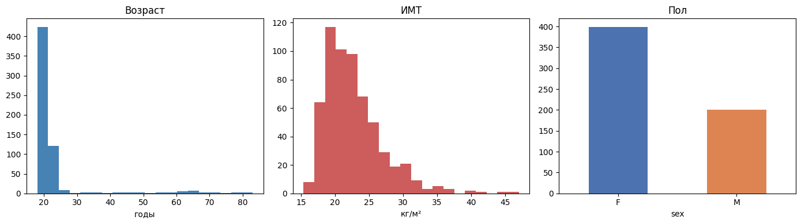
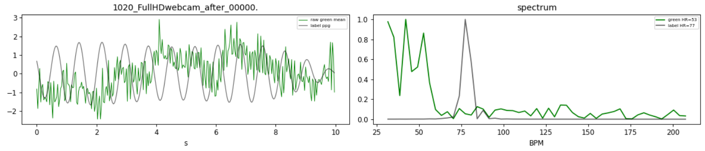

# Восстановление сигнала удалённой фотоплетизмографии из видеопотоков лица

Исследовательский проект по rPPG: бесконтактная оценка пульсовой волны по RGB-видео лица.
Сеть восстанавливает сигнал из окна кадров, ЧСС извлекается из него спектральным методом.

## Конвейер обработки

1. **Детекция лица.** По каждому кадру MediaPipe FaceLandmarker
   определяет ключевые точки; лицо вырезается в bounding box размером 72х72
2. **Формирование окон.** Видео разбивается на перекрывающиеся временные окна
   длины `window` с шагом `stride`.
3. **Нормализация представления.** Кадры центрируются и делятся на стандартное отклонение по всему окну.
   Метки ФПГ подвергаются детренду и полосовой фильтрации Чебышёва II рода
   с последующей нормировкой. Пропуски детекции лица восстанавливаются линейной интерполяцией; 
   записи с долей пропусков выше порога отбраковываются.
4. **Восстановление сигнала.** Выбранная сеть отображает окно `[T,3,H,W]` в сигнал
   `[T]`.
5. **Оценка ЧСС.** Частота выделяется по максимуму спектра мощности (FFT) в
   полосе `[hr_lo_hz, hr_hi_hz]`.

## Модели и функция потерь

**PhysNet** — блоки `Conv3d–BatchNorm3d–ReLU` с пулингом понижают разрешение,
транспонированные свёртки восстанавливают временну́ю ось, адаптивный пулинг убирает
пространственные измерения, свёртка `1×1×1` формирует сигнал.

**FactorizePhys** — временное дифференцирование первым слоем убирает стационарные
компоненты; блоки `Conv3d–TanH–InstanceNorm3d` сжимают кадр,
временная размерность сохраняется на всём протяжении сети. Модуль **FSAM** 
раскладывает временную, канальную и пространственную оси через NMF и использует
низкоранговое приближение как маску внимания.

**RhythmFormer** — иерархический temporal transformer с fusion stem, объединяющим
RGB-кадры и локальные временные разности. Periodic sparse attention сначала
выбирает релевантные пространственно-временные области, а затем вычисляет
внимание только между выбранными областями. Реализация адаптирована к окнам
300 кадров с сохранением исходных временных масштабов `2–4–8`.

**ShiftLoss** — устойчивая к фазовому сдвигу модификация функции потерь на основе
отрицательной корреляции Пирсона. Для каждого окна потери вычисляются при всех
сдвигах в диапазоне `±max_shift` отсчётов, и берётся минимум. Это компенсирует
дрейф задержки между видео и эталонным сигналом ФПГ, не штрафуя за постоянное
фазовое рассогласование.

## Данные и оценка

Обучение проводится на наборе **MCD-rPPG** (мультикамерный набор с
синхронизированными сигналами ФПГ), кросс-датасетная проверка — на **UBFC-rPPG**.
Качество оценивается по средней абсолютной ошибке (MAE) и среднеквадратичной
ошибке (RMSE) оценки ЧСС, а также по корреляции Пирсона восстановленного сигнала
с эталонным ФПГ.

Демографический состав набора MCD-rPPG (распределения возраста, индекса массы тела
и пола субъектов) показан ниже. Выборка смещена в сторону молодого возраста и
преобладания женского пола, вероятно, студенты 



Наличие пульсового сигнала в видеопотоке иллюстрирует усреднённый зелёный канал
области лица в сопоставлении с эталонным ФПГ (слева) и их амплитудные спектры
(справа): несмотря на высокий уровень шума в сыром канале, спектральный пик
согласуется с частотой сердечных сокращений эталона.



## Структура репозитория

```text
models/
  physnet.py       # PhysNet: 3D-CNN
  factorizephys/
    factorizephys.py # FactorizePhys: 3D-CNN с FSAM
    fsam.py          # FSAM: NMF-разложение как многомерное внимание
  rhythmformer.py  # RhythmFormer: periodic sparse temporal transformer
  loss.py          # ShiftLoss (сдвиг-инвариантная отрицательная корреляция Пирсона)

datasets/
  base.py          # DatasetReader
  mcd.py           # чтение MCD-rPPG (видео + синхронный ФПГ)
  ubfc.py          # чтение UBFC-rPPG (видео + синхронный ФПГ)

src/
  config.py        # параметры: пути, препроцессинг, гиперпараметры моделей и обучения
  face_detector.py # детекция лица (MediaPipe)
  preprocess.py    # видео и нормированные временные окна
  dataset.py       # загрузка окон, разбиение train/val по пациентам
  utils.py         # детренд, полосовой фильтр, оценка ЧСС, метрики
  train.py         # цикл обучения, реестр архитектур, расписание lr
  evaluate.py      # кросс-датасетная оценка

result/<architecture>/
  val_patients.json        # фиксированная валидационная выборка, общая для запусков модели
  <ДД.ММ.ГГГГ>/            # один запуск: веса лучшей эпохи + history.json
```

## Установка

```bash
python -m venv .venv
.venv\Scripts\activate
pip install -r requirements.txt
```

Для использования GPU установите сборку PyTorch с поддержкой CUDA. Файл модели
`face_landmarker.task` должен находиться в корне проекта (путь задаётся в
`src/config.py`).

## Запуск

```bash
# 1. Подготовка временных окон из видео
python -m src.preprocess

# 2. Обучение модели
python -m src.train

# 3. Оценка сохранённой модели на отложенном наборе
python -m src.evaluate
```

## Актуальные результаты

| Модель | MAE, BPM ↓ | RMSE, BPM ↓ | Корреляция сигнала ↑ |
|---|---:|---:|---:|
| PhysNet | 5.27 | 8.97 | **0.756** |
| FactorizePhys |7.76 | 12.89 | 0.681 |
| iBVPNet | **4.81** | **6.65** | 0.656 |